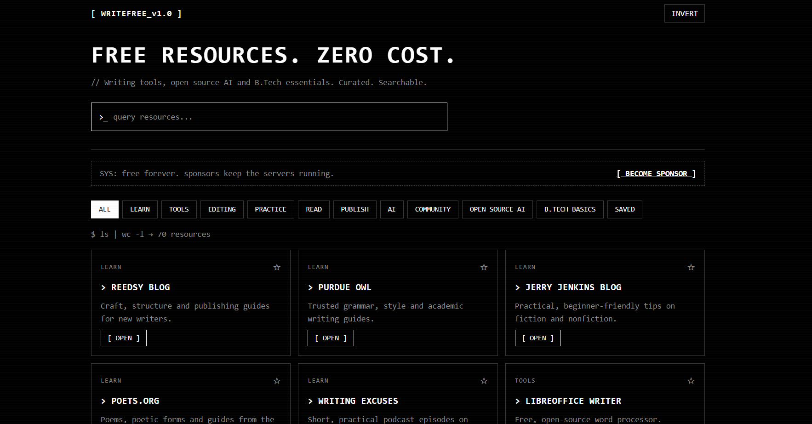
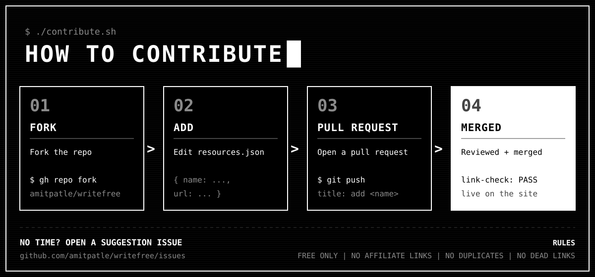

<p align="center">
  
</p>

<h1 align="center">[ WRITEFREE ]</h1>

<p align="center">
  <b>Free resources. Zero cost.</b><br>
  Writing tools · Open-source AI · B.Tech essentials
</p>

<p align="center">
  <a href="https://amitpatle.github.io/writefree/"></a>
  <a href="https://github.com/amitpatle/writefree/issues/new?template=suggest-resource.md"></a>
  <a href="https://github.com/sponsors/amitpatle"></a>
</p>

---

## `$ whoami`

WriteFree is a clean, mobile-friendly, terminal-style website that helps beginners find **quality, cost-free resources** to start and grow their skills. No ads. No paywalls. Just a curated, searchable list.

## `$ ls features/`

- 🔍 Instant search with a debounced filter
- 🏷️ Category chips: Learn, Tools, Editing, Practice, Read, Publish, AI, Community, Open Source AI, B.Tech Basics
- ★ Save favourites (stored in your browser only)
- 🌗 Black and white terminal UI with an **INVERT** theme toggle
- 🆕 `NEW` badge for resources added in the last 30 days
- 📱 Responsive and fast: plain HTML, CSS and JS, no framework
- 🔌 Optional REST API (Node + Express)
- 🚀 Auto-deploy to GitHub Pages with GitHub Actions

## `$ cat categories.txt`

| Category | What you'll find |
|---|---|
| Learn | Guides, blogs and podcasts for new writers |
| Tools | Free editors, notes apps and workspaces |
| Editing | Grammar, readability and dictionary tools |
| Practice | Prompts and critique communities |
| Read | Public-domain books and free libraries |
| Publish | Platforms to share your work |
| AI | Free-tier AI assistants for writing |
| Community | Forums and reader communities |
| Open Source AI | Run LLMs locally: Ollama, llama.cpp, Hugging Face and more |
| B.Tech Basics | CS fundamentals, DSA, Git, Linux, NPTEL and placement prep |

## `$ ./run.sh`

```bash
git clone https://github.com/amitpatle/writefree.git
cd writefree
npm install
npm start          # http://localhost:3000
```

Static only? Serve the `public/` folder with any static server. It reads `public/data/resources.json`.

## `$ curl /api`

| Endpoint | Description |
|---|---|
| `GET /api/resources` | All resources |
| `GET /api/resources?category=AI&q=grammar` | Filter by category and search term |
| `GET /api/categories` | List all categories |

```bash
curl "http://localhost:3000/api/resources?category=Open%20Source%20AI"
```

## `$ tree`

```
writefree/
├── public/
│   ├── index.html
│   ├── css/style.css
│   ├── js/app.js
│   └── data/resources.json
├── server.js              # optional API
├── sys.png                # banner
└── .github/
    ├── workflows/pages.yml
    └── ISSUE_TEMPLATE/suggest-resource.md
```

## `$ git commit -m "add resource"`

Know a great free resource?

<p align="center">
  
</p>


1. Open a [suggestion issue](https://github.com/amitpatle/writefree/issues/new?template=suggest-resource.md), **or**
2. Add an entry to `public/data/resources.json` and open a pull request:


```json
{
  "id": 100,
  "name": "Example",
  "category": "Tools",
  "description": "One short sentence, no marketing.",
  "url": "https://example.com",
  "added": "2026-10-20"
}
```

**Rules:** must be free (a genuine free tier is OK) · no affiliate links · no duplicates · no dead links.

## `$ deploy`

Repo **Settings → Pages → Source: GitHub Actions**, then push to `main`.

## `$ sponsor --help`

Some services needed to run this project cost money. Sponsorship covers those costs and gives me more time to improve the site and add features.

<a href="https://github.com/sponsors/amitpatle">[ BECOME A SPONSOR ]</a>

---

<p align="center">Built by <a href="https://github.com/amitpatle">Amit</a> · MIT License</p>
